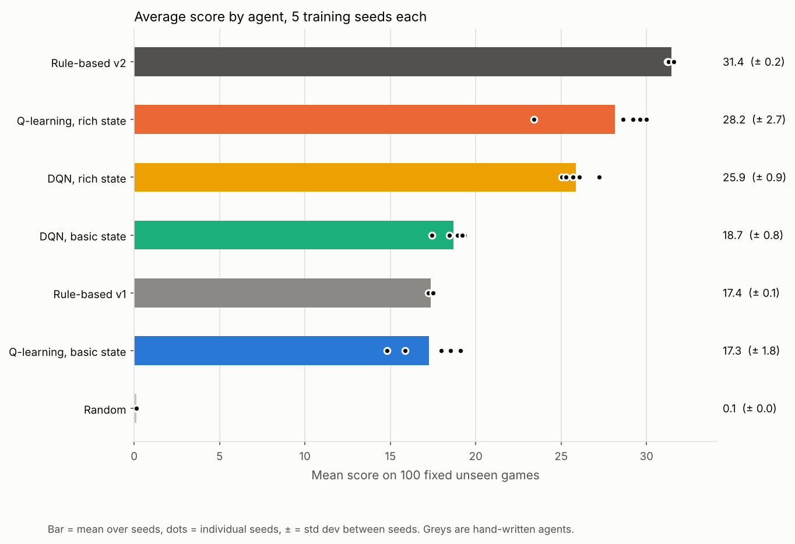

# Snake AI

A small Snake reinforcement-learning project in Python. Everything trains headless on a CPU with
**NumPy, Pandas and Matplotlib**. Pygame is optional and only used for the live viewer.

## Agents

| Agent | What it is | Learns? |
|---|---|---|
| `random` | random move every step | no |
| `rule_v1` | heads for food, avoids immediate collisions (frozen reference baseline) | no |
| `rule_v2` | rule_v1 plus "don't enter a pocket smaller than the snake" | no |
| `q_basic`, `q_rich` | tabular Q-learning | yes |
| `dqn_basic`, `dqn_rich` | Deep Q-Network written in NumPy (MLP, replay buffer, target network, Adam) | yes |

`basic` and `rich` are the two state modes. **Basic** (11 binary features): danger straight/right/left,
heading, food direction. **Rich** (14): basic plus three flood-fill "trap" flags, each 1 when the free area
reachable after that move is smaller than the snake. Actions are relative: straight, turn right, turn left.
Reward: +10 for food, -10 for dying (wall, self, or no food for 100 x length steps).

## Setup and run

```bash
pip install -r requirements.txt          # add `pip install pygame` only if you want the live viewer

python main.py train --agent q   --state rich --episodes 3000     # ~15 s
python main.py train --agent dqn --state rich --episodes 1500     # ~1.5 min
python main.py evaluate --games 100          # all agents on the same 100 fixed unseen games
python main.py replay --agent dqn_rich       # saves results/replay_dqn_rich.gif (no Pygame needed)
python main.py watch  --agent dqn_rich       # Pygame window (add --ascii for text mode)
python main.py plot                          # redraw every graph from the CSVs
```

Trained models for all four learner configurations (seed 0) are included in `results/models/`, so
`evaluate`, `replay` and `watch` work straight away. Run `python main.py --help` for every option.

### Experiments

```bash
python main.py multiseed --seeds 5           # every agent over 5 training seeds, same eval games
python main.py sweep --agent dqn --param gamma --values 0.5 0.9 0.99 --seeds 3
python main.py generalise                    # saved models on 8x8, 12x12, 15x15 (no retraining)
python main.py experiments                   # all of the above with the settings in training/config.py
python main.py experiments --quick           # tiny smoke test, numbers meaningless
```

Training and evaluation are kept apart: evaluation uses fixed seeds starting at 1,000,000 with no
exploration and no learning, and every agent faces the same food sequences.

## Results (what I actually measured)

Setup: 10x10 grid, 5 training seeds per learner (Q-learning 3000 episodes, DQN 1500), each seed scored as
the mean over 100 fixed unseen games. "Spread" is the standard deviation between seeds. The baselines have no
training, so their spread only reflects random tie-breaking. Files: `results/multiseed_results.csv`,
`results/multiseed_summary.csv`.

| Agent | Mean score | Spread | Worst seed | Best seed |
|---|---|---|---|---|
| rule_v2 | 31.5 | 0.2 | 31.2 | 31.6 |
| q_rich | 28.2 | 2.7 | 23.4 | 30.0 |
| dqn_rich | 25.9 | 0.9 | 25.1 | 27.2 |
| dqn_basic | 18.7 | 0.8 | 17.5 | 19.4 |
| rule_v1 | 17.4 | 0.1 | 17.2 | 17.5 |
| q_basic | 17.3 | 1.8 | 14.8 | 19.1 |
| random | 0.1 | 0.0 | 0.1 | 0.2 |



What this supports:

* **The rich state helps both learners, in every seed.** Q-learning 17.3 to 28.2, DQN 18.7 to 25.9. The worst
  rich seed beats the best basic seed for both.
* **With the basic state the learners barely beat the frozen rule_v1 baseline (17.4).** Q-learning is at or
  below it (17.3). DQN is about one point above (18.7, and four of its five seeds are above rule_v1's best 17.5),
  a small edge for a lot of training.
* **Hand-written rule_v2 still beats every learner** here, using exactly the same information. The best
  Q-learning seed (30.0) comes close, but the learners have not caught it under these settings.
* **Most deaths are the snake running into itself** (81 to 95 percent of games for the seed-0 learner models,
  `results/evaluation_games.csv`).

What it does not support:

* **Q-learning vs DQN is not a fair fight yet.** Q-learning got 3000 training episodes and DQN 1500, so do not
  read the 28.2 vs 25.9 as "Q-learning is the better algorithm".
* I expected DQN to pull ahead once the state got richer. It did not. Both state modes are still just binary
  features that a table can store, so DQN has no structural advantage on them. A test of that idea would need a
  much larger or continuous state, which I did not build.

### Training curves


Scores here are measured while exploring (epsilon is still 1 percent at the end), so they sit below the evaluation
numbers. DQN with the rich state peaks near episode 1000 and then drifts down slightly. That fits the sweep below,
where DQN trained for 1000 episodes scored higher (28.5, three seeds) than DQN trained for 1500 (25.9, five seeds).
Longer training is not automatically better for the DQN here.

### Hyperparameter sweeps (rich state, one setting at a time, 3 seeds each)

Q-learning trained 2000 episodes, DQN 1000. Defaults are the middle value of each row. Files:
`results/experiment_results.csv`.

| Agent | Setting | Values tried | Mean eval score for each |
|---|---|---|---|
| Q | gamma | 0.5 / 0.9 / 0.99 | 26.5 / 24.6 / 19.8 |
| Q | alpha | 0.05 / 0.1 / 0.3 | 22.6 / 24.6 / 26.9 |
| Q | eps_decay | 0.99 / 0.998 / 0.9995 | 22.3 / 24.6 / 11.3 |
| DQN | lr | 0.0003 / 0.001 / 0.003 | 29.1 / 28.5 / 28.6 |
| DQN | gamma | 0.5 / 0.9 / 0.99 | 26.1 / 28.5 / 33.2 |
| DQN | eps_decay | 0.98 / 0.995 / 0.999 | 27.0 / 28.5 / 28.1 |
| DQN | batch_size | 16 / 64 / 256 | 27.7 / 28.5 / 28.6 |
| Q | reward_step | -0.1 / -0.01 / 0 | 25.4 / 25.5 / 24.6 |
| DQN | reward_step | -0.1 / -0.01 / 0 | 28.2 / 27.3 / 28.5 |


Reading it:

* **Clear effects (bigger than the seed-to-seed spread):** Q-learning gamma (lower is better here), Q-learning
  eps_decay 0.9995 (exploration is still about 37 percent at episode 2000, so it simply had not finished
  exploring), and DQN gamma 0.99 (all three seeds 31.3 to 35.0).
* **A hint only:** Q-learning alpha, where higher was better (22.6 to 26.9) but neighbouring values overlap.
* **No clear effect:** DQN learning rate, batch size, epsilon decay, and the step penalty for both agents.
  The differences are inside the seed spread.
* **Caution on DQN gamma 0.99 (33.2).** It is higher than rule_v2 (31.5), but it comes from 3 seeds, and the
  sweep is scored on the same 100 evaluation games as the main comparison, which makes a "best setting" look
  better than it will on new games. To claim it, retrain with gamma 0.99 on 5 seeds and score on games with a
  different seed range.

### Other grid sizes (trained on 10x10 only, no retraining), mean score

| Agent | 8x8 | 10x10 | 12x12 | 15x15 |
|---|---|---|---|---|
| rule_v2 | 22.2 | 31.6 | 39.6 | 51.4 |
| q_rich | 22.7 | 29.9 | 36.2 | 47.8 |
| dqn_rich | 19.8 | 26.1 | 33.7 | 41.2 |
| dqn_basic | 15.7 | 18.4 | 20.5 | 23.5 |
| rule_v1 | 15.3 | 17.3 | 20.1 | 23.6 |
| q_basic | 13.3 | 15.9 | 17.8 | 20.2 |
| random | 0.2 | 0.1 | 0.2 | 0.2 |

The order of agents mostly carries over, because the state is relative to the snake rather than tied to a grid
size. These use the seed-0 model of each learner, not the 5-seed average. See `results/graphs/generalisation.png`.

## Viewers

* **GIF replay** (`python main.py replay --agent dqn_rich`): the board plus the agent's value for each move,
  with the chosen move highlighted. Tested here, sample GIFs are in `results/`.
* **Pygame viewer** (`python main.py watch`): same panel live, with SPACE to pause, UP/DOWN for speed, N for
  next game, ESC to quit. **I could not run real Pygame where I built this**, so it is only checked with a
  stand-in for the library. If the window misbehaves on your machine, use `replay` or `--ascii`.

## Limits and ideas

* The Q-learning vs DQN comparison needs matched training budgets (same number of environment steps).
* DQN rich peaks around episode 1000. Saving the best checkpoint, or evaluating at fixed intervals, would be
  more reliable than always taking the last one.
* Sweeps only change one setting at a time, so interactions (for example gamma 0.99 with a different
  epsilon decay) are untested.
* Seeded runs repeat exactly on the same machine and library versions. DQN numbers may differ slightly on
  yours because of floating-point differences.
* A genuinely richer state (for example the full board) is the natural next test of whether DQN can beat a table.

## Layout

```
main.py                    command-line interface
game/environment.py        rules, state modes, reward          game/render.py   Pygame viewer
game/replay.py             GIF replay                          analysis/plots.py   all graphs
agents/                    random, rule_based (v1 and v2), q_learning, dqn
training/train.py          training loop      training/evaluate.py   fixed-seed evaluation
training/sweep.py          one-at-a-time sweeps    training/experiments.py   multi-seed and grid-size tests
training/config.py         experiment settings in one place
results/                   CSVs, models, graphs, GIFs
```
