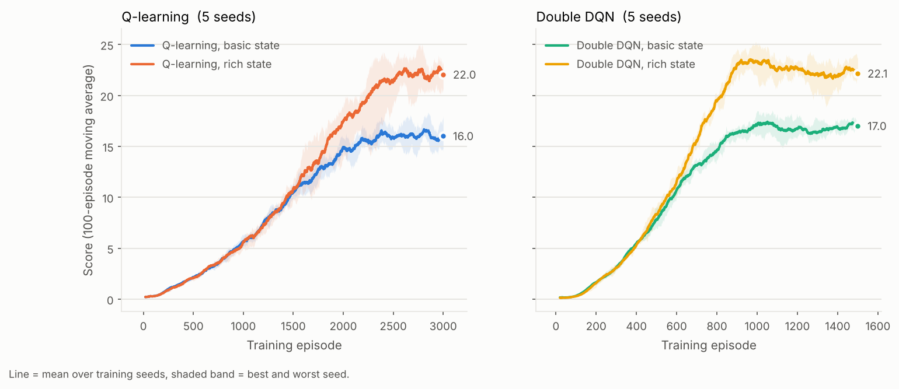
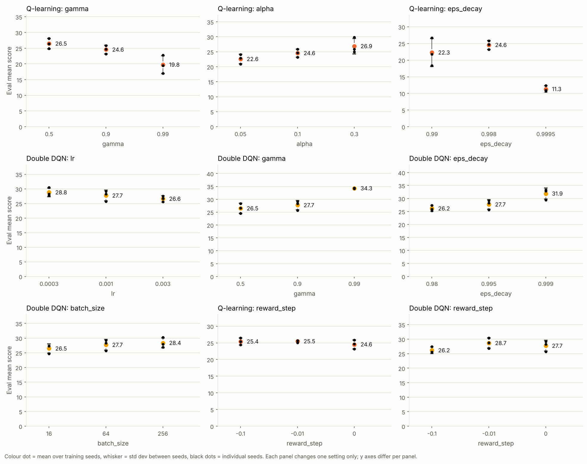

# Snake AI

A small Snake reinforcement-learning project in Python. Everything trains headless on a CPU with
**NumPy, Pandas and Matplotlib**. Pygame is optional and only used for the live viewer.

## Agents

| Agent | What it is | Learns? |
|---|---|---|
| `random` | random move every step | no |
| `rule_v1` | heads for food, avoids immediate collisions (frozen reference baseline) | no |
| `rule_v2` | rule_v1 plus "don't enter a pocket smaller than the snake" | no |
| `q_basic`, `q_rich` | tabular Q-learning | yes |
| `ddqn_basic`, `ddqn_rich` | **Double DQN** in NumPy (MLP, replay buffer, target network, Adam) | yes |

`basic` and `rich` are the two state modes. **Basic** (11 binary features): danger straight/right/left,
heading, food direction. **Rich** (14): basic plus three flood-fill "trap" flags, each 1 when the free area
reachable after that move is smaller than the snake. Actions are relative: straight, turn right, turn left.
Reward: +10 for food, -10 for dying (wall, self, or no food for 100 x length steps).

### Double DQN, and how it differs from DQN

Plain DQN learns from the target `r + gamma * max_a Q_target(s', a)`. Taking the maximum over noisy value
estimates tends to pick whichever action is overestimated, so values drift upwards. Double DQN
(van Hasselt, Guez and Silver, 2016) splits the job between the two networks:

```
a*     = argmax_a Q_online(s', a)        # the online network chooses the next action
target = r + gamma * Q_target(s', a*)    # the target network scores that choice
```

Everything else (network, replay buffer, target-network sync, epsilon-greedy) is the same as before. The
change is `DoubleDQNAgent.double_dqn_targets` in `agents/double_dqn_agent.py`. A check against a hand
calculation confirmed the targets are correct, are never higher than the plain-DQN target, and differ from it
on about half of sampled transitions.

## Setup and run

```bash
pip install -r requirements.txt          # add `pip install pygame` only if you want the live viewer

python main.py train --agent q    --state rich --episodes 3000    # ~15 s
python main.py train --agent ddqn --state rich --episodes 1500    # ~1.5 to 3 min
python main.py evaluate --games 100          # all agents on the same 100 fixed unseen games
python main.py replay --agent ddqn_rich      # saves results/replay_ddqn_rich.gif (no Pygame needed)
python main.py watch  --agent ddqn_rich      # Pygame window (add --ascii for text mode)
python main.py plot                          # redraw every graph from the CSVs
```

Trained models for all four learner configurations (seed 0) are in `results/models/`, so `evaluate`,
`replay` and `watch` work straight away. Run `python main.py --help` for every option.

### Experiments

```bash
python main.py multiseed --seeds 5           # every agent over 5 training seeds, same eval games
python main.py sweep --agent ddqn --param gamma --values 0.5 0.9 0.99 --seeds 3
python main.py generalise                    # saved models on 8x8, 12x12, 15x15 (no retraining)
python main.py experiments                   # all of the above with the settings in training/config.py
python main.py experiments --quick           # tiny smoke test, numbers meaningless
```

Training and evaluation are kept apart: evaluation uses fixed seeds starting at 1,000,000 with no
exploration and no learning, and every agent faces the same food sequences.

## Results (what I actually measured)

Setup: 10x10 grid, 5 training seeds per learner (Q-learning 3000 episodes, Double DQN 1500), each seed scored
as the mean over 100 fixed unseen games. "Spread" is the standard deviation between seeds. Files:
`results/multiseed_results.csv`, `results/multiseed_summary.csv`.

| Agent | Mean score | Spread | Worst seed | Best seed |
|---|---|---|---|---|
| rule_v2 | 31.5 | 0.2 | 31.2 | 31.6 |
| q_rich | 28.2 | 2.7 | 23.4 | 30.0 |
| ddqn_rich | 25.5 | 0.8 | 24.2 | 26.4 |
| ddqn_basic | 18.5 | 0.4 | 17.8 | 18.9 |
| rule_v1 | 17.4 | 0.1 | 17.2 | 17.5 |
| q_basic | 17.3 | 1.8 | 14.8 | 19.1 |
| random | 0.1 | 0.0 | 0.1 | 0.2 |


What this supports:

* **The rich state helps both learners, in every seed.** Q-learning 17.3 to 28.2, Double DQN 18.5 to 25.5.
* **With the basic state the learners barely beat the frozen rule_v1 baseline (17.4).** Double DQN is about
  one point above it, Q-learning is at or below it.
* **Hand-written rule_v2 still beats every learner at default settings**, using the same information.
* **Most deaths are the snake running into itself** (81 to 93 percent of games for the seed-0 learner models,
  `results/evaluation_games.csv`).

What it does not support: **Q-learning vs Double DQN is not a fair fight.** Q-learning got 3000 training
episodes and Double DQN 1500. The `train_time_s` column is also not comparable for Double DQN, because those
runs shared two CPU cores with three other jobs.

### DQN vs Double DQN (same settings, same seeds, same evaluation games)

The plain-DQN results are kept in `results/old_dqn/`.

| Setting | DQN | Double DQN |
|---|---|---|
| basic state, 5 seeds | 18.7 (spread 0.8) | 18.5 (spread 0.4) |
| rich state, 5 seeds | 25.9 (spread 0.9) | 25.5 (spread 0.8) |
| rich, gamma 0.99, 3 seeds | 33.2 (31.3 to 35.0) | 34.3 (34.2 to 34.4) |
| rich, eps_decay 0.999, 3 seeds | 28.1 (24.1 to 31.6) | 31.9 (29.4 to 33.4) |

At the default settings (gamma 0.9) **Double DQN scores the same as DQN**: the differences are smaller than
the spread between seeds. That is not surprising. With gamma 0.9 the target looks only about 10 steps ahead,
so overestimation has little room to build up, and there are just three actions to take a maximum over. The
benefit shows up where the paper says it should, at a **long horizon (gamma 0.99)**: Double DQN gets a
slightly higher mean and a much tighter spread (all three seeds within 0.2 of each other, against a 3.7 point
range for DQN). With three seeds per setting, treat this as a promising result, not a proven one.

### Training curves



Scores here are measured while exploring, so they sit below the evaluation numbers. Double DQN with the rich
state peaks near episode 1000 and then levels off slightly lower, like plain DQN did.

### Hyperparameter sweeps (rich state, one setting at a time, 3 seeds each)

Q-learning trained 2000 episodes, Double DQN 1000. Defaults are the middle value of each row. File:
`results/experiment_results.csv`.

| Agent | Setting | Values tried | Mean eval score for each |
|---|---|---|---|
| Q | gamma | 0.5 / 0.9 / 0.99 | 26.5 / 24.6 / 19.8 |
| Q | alpha | 0.05 / 0.1 / 0.3 | 22.6 / 24.6 / 26.9 |
| Q | eps_decay | 0.99 / 0.998 / 0.9995 | 22.3 / 24.6 / 11.3 |
| Double DQN | lr | 0.0003 / 0.001 / 0.003 | 28.8 / 27.7 / 26.6 |
| Double DQN | gamma | 0.5 / 0.9 / 0.99 | 26.5 / 27.7 / 34.3 |
| Double DQN | eps_decay | 0.98 / 0.995 / 0.999 | 26.2 / 27.7 / 31.9 |
| Double DQN | batch_size | 16 / 64 / 256 | 26.5 / 27.7 / 28.4 |
| Q | reward_step | -0.1 / -0.01 / 0 | 25.4 / 25.5 / 24.6 |
| Double DQN | reward_step | -0.1 / -0.01 / 0 | 26.2 / 28.7 / 27.7 |



* **Clear effects:** Q-learning gamma (lower is better), Q-learning eps_decay 0.9995 (still exploring heavily
  at the end of training), Double DQN gamma 0.99 (34.2 to 34.4 across seeds) and Double DQN eps_decay 0.999.
* **No clear effect:** Double DQN learning rate, batch size, and the step penalty for both agents.
* **Caution on gamma 0.99 (34.3).** It beats rule_v2 (31.5), but it is 3 seeds scored on the same evaluation
  games used to pick it, which flatters a "best setting". To claim it, retrain with gamma 0.99 on 5 seeds and
  score on games with a different seed range.

### Other grid sizes (trained on 10x10 only, no retraining), mean score

| Agent | 8x8 | 10x10 | 12x12 | 15x15 |
|---|---|---|---|---|
| rule_v2 | 22.2 | 31.6 | 39.6 | 51.4 |
| q_rich | 22.7 | 29.9 | 36.2 | 47.8 |
| ddqn_rich | 20.2 | 26.4 | 33.2 | 42.6 |
| ddqn_basic | 15.7 | 18.6 | 22.0 | 26.1 |
| rule_v1 | 15.3 | 17.3 | 20.1 | 23.6 |
| q_basic | 13.3 | 15.9 | 17.8 | 20.2 |
| random | 0.2 | 0.1 | 0.2 | 0.2 |

The order of agents mostly carries over, because the state is relative to the snake rather than tied to a grid
size. These use the seed-0 model of each learner. See `results/graphs/generalisation.png`.

## Viewers

* **GIF replay** (`python main.py replay --agent ddqn_rich`): the board plus the agent's value for each move,
  with the chosen move highlighted.
* **Pygame viewer** (`python main.py watch`): the same panel live. SPACE pause, UP/DOWN speed, N next game,
  ESC quit.

## Limits and ideas

* Matched training budgets (same number of environment steps) are needed for a fair Q-learning vs Double DQN
  comparison.
* Double DQN rich peaks around episode 1000. Keeping the best checkpoint would be more reliable than the last.
* Sweeps change one setting at a time, so combinations (for example gamma 0.99 with eps_decay 0.999) are
  untested and are the obvious next run.
* Seeded runs repeat exactly on the same machine and library versions. Double DQN numbers can differ very
  slightly on other machines because of floating-point differences.

## Reference

van Hasselt, H., Guez, A. and Silver, D. (2016) 'Deep reinforcement learning with double Q-learning',
*Proceedings of the AAAI Conference on Artificial Intelligence*, 30(1). arXiv:1509.06461.

## Layout

```
main.py                     command-line interface
game/environment.py         rules, state modes, reward          game/render.py   Pygame viewer
game/replay.py              GIF replay                          analysis/plots.py   all graphs
agents/                     random, rule_based (v1 and v2), q_learning, double_dqn
training/train.py           training loop      training/evaluate.py   fixed-seed evaluation
training/sweep.py           one-at-a-time sweeps    training/experiments.py   multi-seed and grid-size tests
training/config.py          experiment settings in one place
results/                    CSVs, models, graphs, GIFs (results/old_dqn = plain DQN results, for comparison)
```
